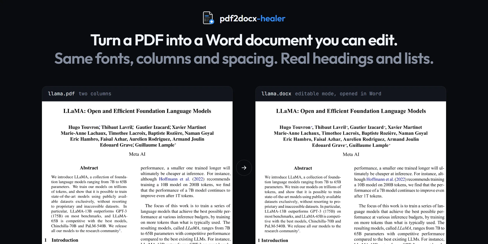
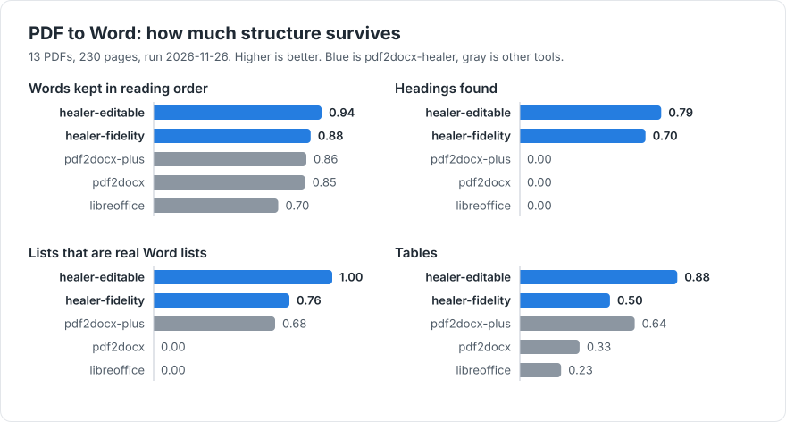

<div align="center">
  <picture>
    <source media="(prefers-color-scheme: dark)" srcset="https://raw.githubusercontent.com/kunalgoesbyken/pdf2docx-healer/main/docs/assets/icon-dark.svg">
    
  </picture>
  <h1>pdf2docx-healer</h1>
  <p>Convert PDF to Word and get a document you can edit: real headings, real lists, working links, tables, and right-to-left text in the right order. A Python library and a command line tool.</p>
  <p>
    <a href="https://pypi.org/project/pdf2docx-healer/"></a>
    <a href="https://pypi.org/project/pdf2docx-healer/"></a>
    <a href="https://github.com/kunalgoesbyken/pdf2docx-healer/actions/workflows/ci.yml"></a>
    <a href="https://github.com/kunalgoesbyken/pdf2docx-healer/blob/main/LICENSE"></a>
  </p>
  <p>
    <a href="#install"><strong>Install</strong></a> ·
    <a href="#benchmark">Benchmark</a> ·
    <a href="https://github.com/kunalgoesbyken/pdf2docx-healer/blob/main/CHANGELOG.md">Changelog</a> ·
    <a href="https://github.com/kunalgoesbyken/pdf2docx-healer/issues/new">Send a PDF that converts badly</a>
  </p>
  <p>Runs on your computer. Your PDFs are never uploaded anywhere.</p>
</div>



Most PDF to Word converters copy how each page looks. The result looks right until you try to edit it: titles are just big bold text, bullets are typed characters, two-column papers come out in the wrong order, and Hebrew or Arabic text comes out in the wrong order. pdf2docx-healer rebuilds what the document means, and in editable mode it keeps how each page looks too. Titles become Word headings, numbered items become Word lists, "see Section 2" becomes a link you can click, and a two-column paper reads top to bottom.

It has the same one-line call as `pdf2docx`: `heal("in.pdf", "out.docx")`. To try it without installing anything:

```bash
uvx --from pdf2docx-healer pdf2docx-heal paper.pdf --mode editable
```

## Why not pdf2docx or LibreOffice?

Both are good at keeping the look of a page. pdf2docx-healer is for when you need to edit the result.

- **Headings you can navigate.** Titles get real heading styles, from the PDF's bookmarks or from font sizes, so Word's navigation pane and table of contents work. In the benchmark, pdf2docx, pdf2docx-plus and LibreOffice found no headings at all.
- **Lists that stay lists.** Bullets, `1.`, `a)`, `iii.` and outlines like `1.2.3` become Word lists that renumber when you edit them.
- **Links inside the document.** Citations, footnote marks and cross references become links to the right place.
- **Reading order.** Editable mode reads two-column pages one column at a time and keeps right-to-left paragraphs in order. On the two-column LLaMA paper it keeps 0.986 of the words in order, against 0.78 for the best of the others. On a Hebrew article it keeps 0.964, against 0.60.
- **No lost pages.** LibreOffice dropped all 36 pages of a Hindi syllabus in the benchmark. When pdf2docx fails on a page, healer rebuilds it from the page's text and images instead of dropping it.

The others still do better in a few places, listed under the [benchmark](#benchmark). If you need a pixel-perfect copy of a form, keep the default mode, which keeps the page layout.

## Install

With [uv](https://docs.astral.sh/uv/):

```bash
uv tool install pdf2docx-healer                  # the pdf2docx-heal command, in its own environment
uvx --from pdf2docx-healer pdf2docx-heal in.pdf  # run once without installing
uv add pdf2docx-healer                           # as a dependency of your project
```

With pip or pipx:

```bash
pip install pdf2docx-healer
pipx install pdf2docx-healer
```

Python 3.10 to 3.13 on Windows, macOS and Linux.

## Quick start

```bash
pdf2docx-heal report.pdf                      # writes report.docx, keeping the page layout
pdf2docx-heal report.pdf --mode editable      # looks like the PDF, reflows when you edit
pdf2docx-heal scan.pdf --ocr --ocr-lang eng   # scanned PDFs (needs Tesseract)
```

```python
from docx_healer import heal, HealerConfig

heal("report.pdf", "report.docx")
heal("report.pdf", "report.docx", config=HealerConfig(mode="editable"))
```

### Two modes

| | `fidelity` (default) | `editable` |
| --- | --- | --- |
| How | `pdf2docx` page by page, then repair passes | Rebuilds the document from the PDF's text, tables and images |
| Looks like | The PDF page | The PDF page, as a normal Word document that reflows when you edit it |
| Best for | Forms, layouts you must keep | Papers, reports, books, right-to-left text, anything you will edit |

Both modes add Word heading styles (from the PDF outline, or font sizes when there is none), real Word lists, clickable web and mail links, internal links for citations and cross references, and font fallbacks for CJK, Arabic, Hebrew, Thai and Devanagari.

Editable mode copies the look of each page: the font family, size, colour, bold and italic of every word, paragraph alignment, indents, the gap between paragraphs, the line spacing, page size, margins and columns. Text running up the margin and boxes set beside other text stay where they are on the page, and white text keeps the coloured box behind it.

In editable mode, repeating headers, footers, logos and page numbers move into the Word header and footer. Lists come through with their real format: bullets, `1.`, `a)`, `iii.`, and outlines like `1.2.3`.

## Benchmark



Run on 2026-11-26 with healer 0.3.0, pdf2docx 0.5.13, pdf2docx-plus 0.6.10 and LibreOffice (headless, `writer_pdf_import`), on 12 public PDFs plus one generated test PDF, 230 pages in all. Every number is computed from the PDF and the produced DOCX; nothing is read from logs. `python -m bench.run` reproduces it, and [`bench/README.md`](https://github.com/kunalgoesbyken/pdf2docx-healer/blob/main/bench/README.md) has the corpus, the per-document rows and the exact definitions.

| Tool | Word recall | Recall any order | Headings | Real lists | Number shown | Internal links | Tables | Images | Pages lost | Median s |
| --- | --- | --- | --- | --- | --- | --- | --- | --- | --- | --- |
| **healer editable** | **0.941** | 0.991 | **0.79** | **1.00** | **1.00** | 0.85 | **0.88** | 0.84 | **0/230** | 6.3 |
| **healer fidelity** | 0.879 | **0.992** | 0.70 | 0.76 | **1.00** | **0.95** | 0.50 | 0.66 | **0/230** | **5.9** |
| pdf2docx-plus | 0.855 | 0.986 | 0.00 | 0.68 | 0.88 | 0.00 | 0.64 | 0.66 | **0/230** | 7.3 |
| pdf2docx | 0.848 | 0.958 | 0.00 | 0.00 | **1.00** | 0.00 | 0.33 | 0.66 | **0/230** | 6.7 |
| LibreOffice | 0.698 | 0.929 | 0.00 | 0.00 | 0.00 | 0.00 | 0.23 | **0.93** | 36/230 | 11.0 |

Where the others still win: LibreOffice has the best image score, because the score counts raster images only, so it gets credit for leaving out the vector charts that healer turns into pictures. pdf2docx-plus scores better on tables than healer's default mode (0.64 against 0.50; editable mode scores 0.88). In editable mode healer is a little behind pdf2docx-plus on the Chinese text (0.958 against 0.993) and on the Mixtral paper (0.928 against 0.951); the default mode scores 1.000 and 0.950 on those two.

### Does it look like the PDF?

`python -m bench.visual --renderer word` opens each DOCX in Word, saves it as a PDF and compares it with the original word by word: is the word on the same page, near the same spot, and in the same size, colour, weight, slant and kind of font. It also writes side-by-side pictures of every page. First 3 pages of each document, 2026-11-26:

| Mode | Same page | Same spot | Size | Colour | Bold | Italic | Font kind |
| --- | --- | --- | --- | --- | --- | --- | --- |
| **healer editable 0.4.0** | **0.74** | **0.41** | **0.74** | **0.74** | **0.73** | **0.74** | 0.58 |
| healer default 0.4.0 | 0.70 | **0.41** | 0.65 | 0.69 | 0.67 | 0.69 | **0.60** |
| healer editable 0.3.2 | 0.49 | 0.07 | 0.36 | 0.39 | 0.46 | 0.48 | 0.32 |

The scanned patent scores 0 in both modes because it has no text layer. LibreOffice lays the same files out a little differently (editable 0.58 same page, 0.25 same spot), mostly because it does not squeeze word spaces in justified text the way Word and TeX do, and it handles right-to-left text in pinned boxes less well. Drawn lines and shapes are not copied yet.

## Options

| CLI | `HealerConfig` | Default | What it does |
| --- | --- | --- | --- |
| `--mode` | `mode` | `fidelity` | `fidelity` or `editable` |
| `--ocr`, `--ocr-lang`, `--ocr-dpi`, `--ocr-threshold` | `ocr_enabled`, `ocr_lang`, `ocr_dpi`, `ocr_threshold` | off, `eng`, 300, 0.3 | OCR pages without text |
| `--no-headings` | `fix_headings` | on | Fidelity: heading styles |
| `--no-lists` | `fix_lists` | on | Fidelity: real Word lists |
| `--no-hyperlinks` | `fix_hyperlinks` | on | Clickable web and mail links |
| `--no-internal-links` | `fix_internal_links` | on | Fidelity: links to other places in the document |
| `--no-font-fix` | `fix_fonts` | on | Font fallbacks |
| `--no-table-filter` | `fix_tables` | on | Fidelity: drop tables that are only page layout |
| `--no-page-recovery` | `recover_pages` | on | Fidelity: rebuild a page pdf2docx fails on |
| `--aggressive` | `aggressive_lists` | off | Fidelity: split paragraphs more eagerly to find lists |
| `-q` | `verbose=False` | | No progress output |

Editable mode always builds headings, lists and internal links, so the three switches marked Fidelity only apply to the default mode.

`heal()` returns the output path. It raises `FileNotFoundError` for a missing input. It raises `InvalidInputError` (a `ValueError`) for a non-PDF or unreadable input, a missing output folder, an output path equal to the input, or a bad option. A failure in one repair pass is logged as a warning on the `docx_healer` logger and the other passes still run. The command exits with 0 on success, 1 on failure and 2 for bad options.

The output is written only when the whole conversion has finished, so a failure never leaves a half-written file and never replaces an existing one. Your PDF is never changed.

### Safety

- **Links:** only `http`, `https`, `mailto` and `ftp` links are kept as links; anything else, such as `file:`, `javascript:` or network paths, becomes plain text. This check always runs, and if it fails the conversion fails.
- **Large PDFs:** editable mode caps images, image size and pixels, drawings and table time, so a hostile PDF cannot exhaust memory.
- **OCR:** runs through PyMuPDF and needs [Tesseract](https://github.com/tesseract-ocr/tesseract) on `PATH` or `TESSDATA_PREFIX`. Without it, scanned pages are kept as images and a warning is logged.

## Requirements

- Python 3.10+
- `pdf2docx >= 0.5.9, < 0.6`, `PyMuPDF >= 1.27.1`, `python-docx >= 1.1.0`, `lxml >= 4.9`
- [Tesseract](https://github.com/tesseract-ocr/tesseract), optional, for OCR

## Found a PDF that converts badly?

[Open an issue](https://github.com/kunalgoesbyken/pdf2docx-healer/issues/new) and attach the PDF, or a link to it, with what went wrong. Bad conversions are the fastest way to make this better.

## Development

```bash
uv sync --extra dev
uv run pytest
uv run ruff check src tests bench
uv run mypy
```
